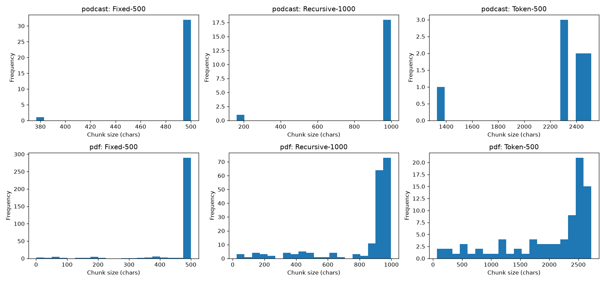
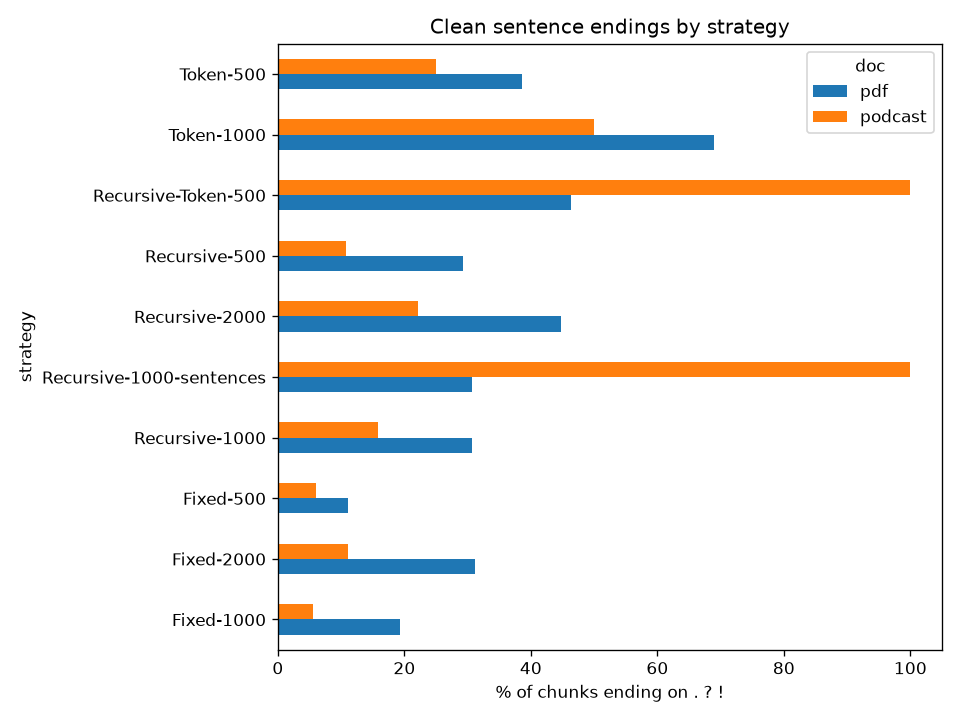

# Lab proof: chunking strategies for a podcast and a PDF

**Notebook:** `chunking_strategies.ipynb` (run top to bottom; its last cell generates this file).

## 1. Sources

| Source | Loaded as | Size | Structure |
|---|---|---|---|
| Podcast | `audio_small.m4a` → Whisper transcript (`transcript.txt`, 445 timestamped segments) | 16,377 chars / 3,447 tokens | 0 blank lines, 0 line breaks |
| PDF | `ai_hleg_ethics_guidelines_for_trustworthy_ai-en_87F84A41-A6E8-F38C-BFF661481B40077B_60419 (1).pdf` via PyPDFLoader, one Document per page | 41 pages, 155,474 chars / 30,902 tokens | 0 blank lines, 1892 line breaks |

## 2. Workflow

- **INPUT:** podcast audio (transcribed once with Whisper, saved locally) and a PDF (one Document per page).
- **DECIDE:** retrieval path. Chunk with each strategy, index the chunks with TF-IDF, retrieve the top 3 for one query.
- **BUILD:** split → statistics → plots → retrieve → answer only from the retrieved chunks, with `[C#]` citations.
- **VERIFY:** every chunk carries `source`, `chunk_id`, `start_index` and a PDF page number or a podcast timestamp; citations are checked against the retrieved set.
- **EXPLAIN:** failure and limitation in section 6.

```python
CharacterTextSplitter(separator="", chunk_size=500, chunk_overlap=0)            # Fixed-500
RecursiveCharacterTextSplitter(chunk_size=1000, chunk_overlap=100)            # Recursive-1000
RecursiveCharacterTextSplitter(chunk_size=1000, chunk_overlap=100,             # Recursive-1000-sentences
    separators=["\n\n", "\n", ". ", "? ", "! ", " ", ""], keep_separator="end")
TokenTextSplitter(encoding_name="cl100k_base", chunk_size=500, chunk_overlap=50) # Token-500
```

## 3. Chunk statistics

| doc | strategy | # chunks | avg chars | min | max | avg tokens | % clean endings |
|---|---|---|---|---|---|---|---|
| podcast | Fixed-500 | 33 | 496 | 377 | 500 | 105 | 6.1 |
| podcast | Fixed-1000 | 18 | 957 | 227 | 1000 | 202 | 5.6 |
| podcast | Fixed-2000 | 9 | 1908 | 1177 | 2000 | 402 | 11.1 |
| podcast | Recursive-500 | 37 | 488 | 189 | 499 | 103 | 10.8 |
| podcast | Recursive-1000 | 19 | 953 | 161 | 999 | 201 | 15.8 |
| podcast | Recursive-2000 | 9 | 1905 | 1183 | 1999 | 401 | 22.2 |
| podcast | Recursive-1000-sentences | 19 | 913 | 189 | 991 | 193 | 100.0 |
| podcast | Token-500 | 8 | 2257 | 1328 | 2514 | 475 | 25.0 |
| podcast | Token-1000 | 4 | 4454 | 3591 | 4817 | 937 | 50.0 |
| podcast | Recursive-Token-500 | 9 | 1989 | 671 | 2269 | 419 | 100.0 |
| pdf | Fixed-500 | 333 | 466 | 1 | 500 | 94 | 11.1 |
| pdf | Fixed-1000 | 187 | 869 | 53 | 1000 | 174 | 19.3 |
| pdf | Fixed-2000 | 103 | 1568 | 65 | 2000 | 312 | 31.1 |
| pdf | Recursive-500 | 366 | 426 | 29 | 497 | 85 | 29.2 |
| pdf | Recursive-1000 | 189 | 833 | 25 | 998 | 166 | 30.7 |
| pdf | Recursive-2000 | 103 | 1516 | 65 | 1998 | 302 | 44.7 |
| pdf | Recursive-1000-sentences | 189 | 833 | 25 | 998 | 166 | 30.7 |
| pdf | Token-500 | 83 | 1999 | 65 | 2722 | 398 | 38.6 |
| pdf | Token-1000 | 45 | 3493 | 65 | 5183 | 695 | 68.9 |
| pdf | Recursive-Token-500 | 84 | 1953 | 65 | 2710 | 388 | 46.4 |





## 4. Analysis (from the numbers above)

- **Does fixed-size break sentences?** Yes. Fixed-500 ends on `. ? !` in only 6.1% of podcast chunks and 11.1% of PDF chunks; it cuts mid-word. The **pdf** handles fixed-size chunking better.
- **Recursive vs fixed (1000):** clean endings 15.8% vs 5.6% (podcast), 30.7% vs 19.3% (PDF).
- **Structure:** the transcript has 0 blank lines, so default recursive splitting falls back to spaces. Putting sentence ends first in the separator list raises podcast clean endings to 100.0%. The PDF has 0 blank lines and 1892 line breaks for recursive splitting to use.
- **Token vs character:** Token-500 chunks average 2257 chars (podcast) and 1999 chars (PDF), so the same token budget holds a different amount of text per source. Token limits map directly to the LLM context window; character limits do not.

## 5. Grounding trace (one query)

**Query:** What are three components of trustworthy AI

**Retrieved with Fixed-500:**

| # | chunk_id | where | TF-IDF score | evidence (start of chunk) |
|---|---|---|---|---|
| C1 | `pdf|Fixed-500|9` | PDF p.4 | 0.497 | t in itself is necessary but not sufficient for the achievement of Trustworthy AI. Ideally, all three components work in harmony and overlap in their operation. If, in practice, tensions arise between these components, s |
| C2 | `pdf|Fixed-500|297` | PDF p.37 | 0.301 | context, it is important to build AI systems that are worthy of trust, since human beings will only be able to confidently and fully reap its benefits when the technology, including the processes and people behind the te |
| C3 | `pdf|Fixed-500|6` | PDF p.3 | 0.264 | 1 TABLE OF CONTENTS EXECUTIVE SUMMARY 2 A. INTRODUCTION 4 B. A FRAMEWORK FOR TRUSTWORTHY AI 6 I. Chapter I: Foundations of Trustworthy AI 9 II. Chapter II: Realising Trustworthy AI 14 1. Requirements of Trustworthy AI 14 |

**Retrieved with Recursive-1000-sentences:**

| # | chunk_id | where | TF-IDF score | evidence (start of chunk) |
|---|---|---|---|---|
| C1 | `pdf|Recursive-1000-sentences|5` | PDF p.4 | 0.440 | 2 EXECUTIVE SUMMARY The aim of the Guidelines is to promote Trustworthy AI. Trustworthy AI has three components, which should be met throughout the system's entire life cycle: (1) it should be lawful, complying with all  |
| C2 | `pdf|Recursive-1000-sentences|22` | PDF p.7 | 0.300 | 1. it should be lawful, complying with all applicable laws and regulations; 2. it should be ethical, ensuring adherence to ethical principles and values; and 3. it should be robust, both from a technical and social persp |
| C3 | `pdf|Recursive-1000-sentences|21` | PDF p.7 | 0.289 | 5 benefits that they can bring. To help Europe realise those benefits, our vision is to ensure and scale Trustworthy AI. Trust in the development, deployment and use of AI systems concerns not only the technology’s inher |

**Final output** (gpt-4o-mini, context = Recursive-1000-sentences top 3):

> The three components of Trustworthy AI are: (1) it should be lawful, complying with all applicable laws and regulations; (2) it should be ethical, ensuring adherence to ethical principles and values; and (3) it should be robust, both from a technical and social perspective, since, even with good intentions, AI systems can cause unintentional harm. [C1]

**Verification:**

- Citations in the answer: [1]; all point to retrieved chunks: **True**; model refused: False.
- Trace for the reviewer: [C1] = `pdf|Recursive-1000-sentences|5` at **PDF p.4** (top score 0.44).

## 6. Failure and limitation

1. **Default `CharacterTextSplitter` is not fixed-size.** Its default separator is `"\n\n"`. The transcript has 0 blank lines, so it returned 1 chunk(s), the largest 16,377 chars against a 1,000 target. Fix: `separator=""` for true fixed-size, or recursive splitting with sentence separators.
2. **Fixed chunks cut evidence mid-sentence.** The top Fixed-500 hit for the query ends mid-sentence: "…1 Instead, it aims to offer guidance on the second and third components: foster"
3. **Where a plausible but unsupported answer can appear:** TF-IDF matches words, not meaning. If the top chunk is a half-sentence, or the answer spans two chunks or two PDF pages (chunks never cross a page here), the LLM can fill the gap from its own knowledge. Guards used: answer only from context, a `[C#]` citation on every claim, "Not in the sources" as the fallback, and the citation check above. Not covered: the check confirms that a cited chunk exists, not that it supports the claim.

## 7. Recommendations

### For PDF documents:
**Recommended strategy:** Token-1000
**Reasoning:**
- Highest clean-ending rate for the PDF among non-fixed strategies (68.9%), versus 11.1% for Fixed-500.
- Uses the PDF's own line and paragraph breaks; page numbers stay in metadata, so every answer can cite a page.
- Size: about 3493 chars / 695 tokens per chunk, with ~10% overlap so sentences cut at a boundary appear in both chunks.

### For podcast transcripts:
**Recommended strategy:** Recursive-1000-sentences
**Reasoning:**
- The transcript has no paragraph breaks, so sentence-level separators carry the structure: 100.0% clean endings versus 6.1% for Fixed-500.
- Each chunk maps back to a timestamp, so the reviewer can jump to that point in the audio.
- Size: about 913 chars / 193 tokens per chunk, with overlap so a speaker's point is not split from its context.

### Trade-offs summary:
| Strategy | Pros | Cons | Best for |
|---|---|---|---|
| Fixed-size | Simple, predictable | Breaks context, cuts mid-word | Uniform content |
| Recursive | Preserves structure | Needs the right separators (transcripts have none) | Structured docs |
| Token-based | Accurate for LLM limits | Requires a matching tokenizer | LLM integration |
| Semantic | Meaning-based | Computationally expensive, needs an embedding model | Complex content |
